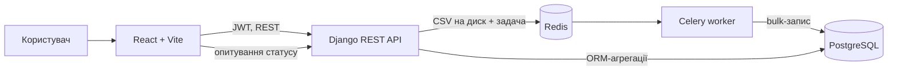
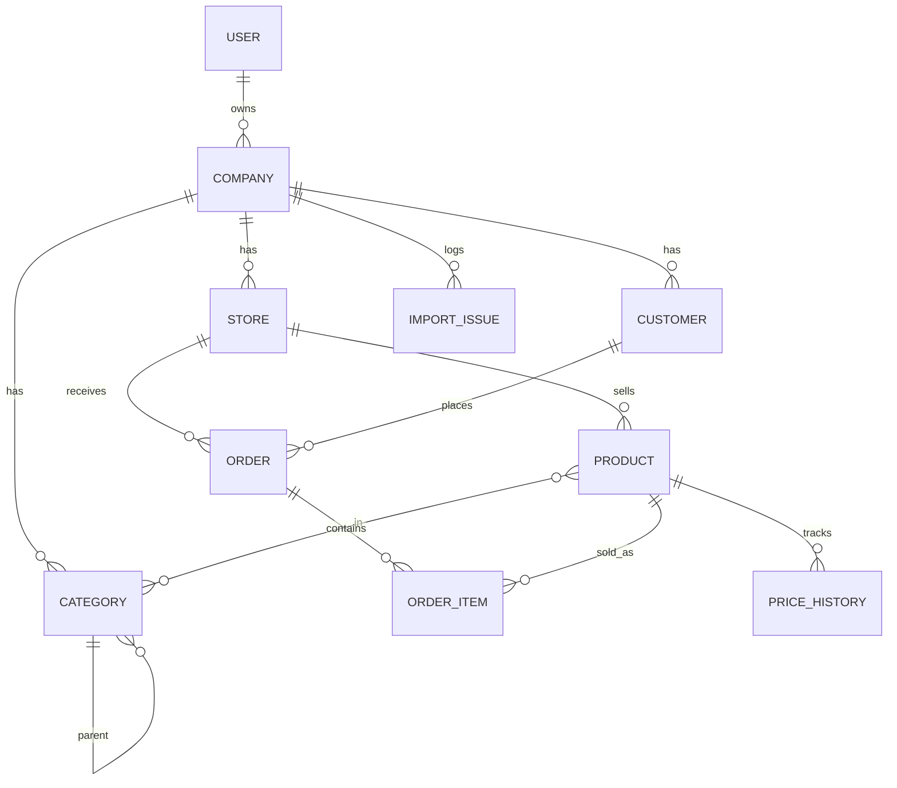

markdown
# Analitic SaaS B2B

Вебсервіс для B2B-аналітики продажів. Власник магазину завантажує каталог товарів та історію продажів у вигляді CSV, платформа обробляє файли у фоні, зберігає дані в PostgreSQL і будує інтерактивні дашборди, які користувач збирає сам.

> **Статус:** навчальний / пет-проєкт у розробці. Не призначений для продакшену (див. [План розвитку](#план-розвитку)).

<!-- TODO: додати скриншот дашборду:  -->
<!-- TODO: додати GIF завантаження CSV із прогрес-баром -->

---

## Зміст

- [Можливості](#можливості)
- [Технологічний стек](#технологічний-стек)
- [Швидкий старт](#швидкий-старт)
- [Формат CSV](#формат-csv)
- [Архітектура](#архітектура)
- [Структура репозиторію](#структура-репозиторію)
- [Ключові інженерні рішення](#ключові-інженерні-рішення)
- [API](#api)
- [Конфігурація віджета](#конфігурація-віджета)
- [Тести](#тести)
- [Корисні команди](#корисні-команди)
- [План розвитку](#план-розвитку)

---

## Можливості

- **Автентифікація (JWT).** Реєстрація створює користувача разом із компанією; вхід та оновлення токена через `simplejwt`.
- **Асинхронний імпорт CSV.** Каталог товарів і історія продажів обробляються Celery-задачами (`process_warehouse_data`, `process_sales_data`), тому API не блокується на великих файлах. Фронтенд опитує статус задачі (`/api/check-status/<task_id>/`) і показує прогрес.
- **Журнал проблем імпорту (`ImportIssue`).** Під час обробки рядків фіксуються конфлікти: різні email або дати в межах одного замовлення, різні статуси, товари з невідомим SKU (створюються як чернетки). Кожна проблема прив'язана до задачі та номера рядка.
- **Конструктор дашбордів.** Користувач сам обирає метрику, тип відображення (лінійний графік, гістограма, кругова діаграма, таблиця), період, магазини та групування. Конфігурація віджетів зберігається в полі `Company.dashboard_preferences` (`JSONField`), розташування віджетів додатково запам'ятовується в `localStorage`.
- **Гнучкий аналітичний рушій.** Усі метрики побудовані на спільному класі `BasicAnalytics` з конвеєром pre/post-обробки: фільтри за датами, магазинами та статусами, `group_and_limit`, сортування, ліміти, заповнення пропусків у часових рядах (`fill_blank`).
- **Кешування відповідей аналітики** на 15 хвилин за ключем із параметрів запиту (див. [План розвитку](#план-розвитку)).

---

## Технологічний стек

| Шар | Технології |
| --- | --- |
| Backend | Python 3.11, Django 5.2, Django REST Framework, `djangorestframework-simplejwt`, `django-cors-headers` |
| База даних | PostgreSQL 15 (агрегації, групування, віконні функції) |
| Фонові задачі | Celery, Redis 7 (брокер і backend результатів) |
| Frontend | React 19, Vite, React Router, Axios, Recharts |
| Інфраструктура | Docker, Docker Compose, pgAdmin 4 |

---

## Швидкий старт

**Потрібно:** Docker та Docker Compose.

```bash
# 1. Клонувати репозиторій
git clone https://github.com/IgorPel/analitic_SaaS_B2B.git
cd analitic_SaaS_B2B

# 2. Створити файл змінних оточення
cp .env.example .env
# за потреби відредагуйте значення в .env

# 3. Зібрати та запустити всі сервіси
docker compose up --build

# 4. В іншому терміналі: застосувати міграції
docker compose exec backend python src/manage.py migrate

```

Далі:

1. Відкрийте **http://localhost:5173** і зареєструйтесь (буде створено користувача та компанію).
2. Перейдіть на сторінку завантаження каталогу (`/upload/warehouse`), вкажіть назву магазину та завантажте `src/analytics/test_data/test_analytics/catalogs/products.csv`.
3. На сторінці `/upload/sales` завантажте `src/analytics/test_data/sales_data.csv` (15 000 рядків) для того самого магазину.
4. Після завершення задач відкрийте дашборд (`/`) або конструктор віджетів (`/builder`).

### Сервіси та порти

| Контейнер | Призначення | Порт |
| --- | --- | --- |
| `frontend` | React-застосунок (Vite dev server) | `5173` |
| `analytics_backend` | Django REST API | `8000` |
| `analytics_db` | PostgreSQL 15 | `5432` |
| `analytics_redis` | Redis 7 | `6379` |
| `analytics_worker` | Celery worker | — |
| `pgadmin` | Вебінтерфейс БД | `5050` (логін і пароль — `PG_EMAIL` / `PG_PASSWORD`) |

> Порти БД і Redis відкриті назовні лише для зручності розробки.

### Змінні оточення (`.env`)

| Змінна | Призначення |
| --- | --- |
| `SECRET_KEY` | Секретний ключ Django |
| `CACHE` | URL Redis (також використовується як брокер Celery), напр. `redis://redis:6379/0` |
| `DB`, `DB_USER`, `DB_PASSWORD` | Назва бази та облікові дані PostgreSQL |
| `PG_EMAIL`, `PG_PASSWORD` | Обліковий запис pgAdmin |

---

## Формат CSV

**Каталог товарів** (`/api/upload-store-data/`):

```csv
product_sku,product_name,category_path,price
SKU-1008,test-1008,Electronics > Phones,870.79

```

`category_path` описує ієрархію категорій через `>`; відсутні категорії створюються автоматично.

**Історія продажів** (`/api/upload-sales-data/`):

```csv
order_id,customer_email,product_sku,quantity,price,order_date,status
ORD-2026-00001,customer@example.com,SKU-1008,8,870.79,2026-07-17,COMPLETED

```

* Один `order_id` може займати кілька рядків (по одному на позицію замовлення).
* Статуси: `COMPLETED`, `CANCELED`, `RETURNED`.
* Якщо SKU немає в каталозі, товар створюється як чернетка, а в журнал імпорту додається запис `MISSING_SKU`. Тому каталог краще завантажувати першим.
* Приймаються лише файли `.csv` (UTF-8).

Приклади лежать у `src/analytics/test_data/`.

---

## Архітектура



### Структура репозиторію

```text
analitic_SaaS_B2B/
├── docker-compose.yml          # Оркестрація 6 сервісів (backend, db, redis, worker, frontend, pgadmin)
├── Dockerfile                  # Образ для Django API та Celery worker
├── requirements.txt            # Python-залежності
├── src/
│   ├── core/                   # Налаштування Django, Celery та кореневі маршрути
│   └── analytics/              # Основний застосунок аналітики
│       ├── models.py           # Моделі даних (Company, Store, Product, Order, ImportIssue тощо)
│       ├── analytic_func.py    # Аналітичне ядро (BasicAnalytics, LTV, Revenue, CohortAnalyze)
│       ├── tasks.py            # Celery-задачі імпорту каталогу та продажів
│       ├── views.py            # REST API контролери та кешування
│       └── test_data/          # Тестові CSV-файли (зокрема sales_data.csv на 15 000 рядків)
└── frontend/
    ├── Dockerfile              # Образ для React (Vite dev server)
    └── src/
        ├── api/axios.js        # Налаштування клієнта та перехоплювачів JWT
        ├── context/            # AuthContext (керування сесією користувача)
        ├── pages/              # Сторінки: DashboardPage, UploadPage, LoginPage, RegisterPage
        └── components/
            └── dashboard/      # Конструктор віджетів (WidgetBuilderPage) та графіки (Bar, Line, Pie, Table)

```

### Моделі (`analytics`)



* `Company` містить `dashboard_preferences` (JSON) з конфігурацією віджетів.
* `Order` має статуси `CM` (Completed), `CN` (Canceled), `RT` (Returned) та унікальність пари `(store, order_id)`.
* `Category` підтримує вкладені підкатегорії через `parent`.

### Ключові інженерні рішення

1. **Двофазний аналітичний конвеєр (`BasicAnalytics`):**
Замість дублювання ORM-запитів у кожному контролері, всі метрики успадковуються від базового класу `BasicAnalytics` (`src/analytics/analytic_func.py`). Обробка проходить через:
* `_pre_pipeline`: базова фільтрація за магазинами (`stores_id`), статусами замовлень та діапазоном дат.
* `func()`: специфічна бізнес-логіка метрики (наприклад, віконні функції `Window(expression=Sum(...), partition_by=...)` для розрахунку накопичувального LTV).
* `_post_pipeline`: динамічне групування та агрегація (`_post_group_and_limit`), сортування та заповнення пропусків у часових рядах (`_post_fill_gaps` — підтримує стратегії `DefaultValue` для заповнення нулями та `DefaultValueLeft` для збереження попереднього накопичувального значення).


2. **Відмовостійкий парсинг CSV (`ImportIssue`):**
Під час імпорту великих файлів через Celery помилка в одному рядку не зупиняє весь процес. Система автоматично створює товари-чернетки для невідомих артикулів (`MISSING_SKU`) та логує невідповідності даних у таблицю `ImportIssue` із прив'язкою до `task_id` і номера рядка для подальшого аудиту користувачем.

---

## API

Усі ендпоінти мають префікс `/api/` і (крім реєстрації та входу) вимагають заголовок `Authorization: Bearer <access_token>`.

### Автентифікація та користувач

| Метод | Ендпоінт | Опис |
| --- | --- | --- |
| `POST` | `/api/auth/register/` | Реєстрація користувача разом із компанією (`username`, `password`, `email`, `company_name`) |
| `POST` | `/api/auth/login/` | Отримання пари access/refresh токенів |
| `POST` | `/api/auth/token/refresh/` | Оновлення access-токена |
| `GET` | `/api/auth/me/` | Профіль, компанія та її магазини |

### Імпорт даних

| Метод | Ендпоінт | Опис |
| --- | --- | --- |
| `POST` | `/api/upload-store-data/` | Завантаження каталогу (`multipart`: `file`, `store_name`), повертає `task_id` |
| `POST` | `/api/upload-sales-data/` | Завантаження продажів (`multipart`: `file`, `store_name`), повертає `task_id` |
| `GET` | `/api/check-status/<task_id>/` | Статус і прогрес Celery-задачі |
| `GET` | `/api/task-issues/?tasks_id=...` | Проблеми, виявлені під час імпорту |

### Аналітика (`GET`)

| Ендпоінт | Опис | Візуалізація |
| --- | --- | --- |
| `/api/revenue/` | Виторг по днях (`TruncDay` + `Sum`) | Лінійний графік |
| `/api/ltv/` | Накопичувальний виторг по клієнтах (віконна функція `Sum` з `partition_by`) | Лінійний графік / таблиця |
| `/api/top-categories/` | Виторг за категоріями товарів | Кругова діаграма |
| `/api/top-products/` | Топ товарів | Гістограма / таблиця |
| `/api/general-stats/` | Загальні показники: виторг, кількість замовлень, середній чек | KPI-картки |
| `/api/analyze-sales/` | Продажі товару за цінами (основа для аналізу цінової еластичності) | Таблиця / графік |

**Спільні параметри запиту:** `start_date`, `end_date` (за замовчуванням останні 30 днів), `stores_id` (список UUID), `statuses`, `limits`, `fields`, `orders_by`, `group_and_limit` (JSON), `fill_blank` (JSON), `unique_dates`, `graphs`, `x_axis`. За замовчуванням враховуються лише завершені замовлення.

### Налаштування дашборду

| Метод | Ендпоінт | Опис |
| --- | --- | --- |
| `GET` | `/api/dashboard-preferences/` | Список віджетів поточної компанії |
| `POST` | `/api/dashboard-preferences/` | Додати віджет |
| `PATCH` | `/api/dashboard-preferences/` | Замінити весь масив віджетів |
| `DELETE` | `/api/dashboard-preferences/<widget_id>/` | Видалити віджет |

---

## Конфігурація віджета

Фронтенд формує та зберігає об'єкти такого вигляду:

```json
{
  "id": "d9b2d63d-4c3a-412f-9871-34f8a2b5e7d9",
  "func": "top_products",
  "para": {
    "date_range": { "start": "2026-07-01", "end": "2026-07-15" },
    "group_and_limit": {
      "limit": 10,
      "group_by": { "product__name": "F", "quantity": "Sum" },
      "order_by": ["-quantity_sum"]
    }
  },
  "chart": {
    "type": "Table",
    "x_axis": "product__name",
    "y_axis": "quantity_sum"
  },
  "stores": ["6a2d045a-25ad-442a-afd6-347168c9c535"]
}

```

У `group_by` значення `"F"` означає поле групування, а `Sum`, `Avg`, `Count`, `Max`, `Min` додають агрегацію з іменем `<поле>_<функція>`.

---

## Тести

Тести охоплюють імпорт каталогу та продажів, аналітичні функції (виторг, LTV, когорти, `fill_gaps`) і API налаштувань дашборду. Під час тестів Celery працює в режимі `ALWAYS_EAGER`.

```bash
docker compose exec backend python src/manage.py test analytics -v 2

```

---

## Корисні команди

```bash
# Міграції
docker compose exec backend python src/manage.py makemigrations
docker compose exec backend python src/manage.py migrate

# Логи бекенду
docker compose logs backend -f --tail=0

# Перезапуск Celery-воркера після змін у задачах
docker compose restart worker

```

---

## План розвитку

* **Безпека та мульти-тенантність:** Жорстка ізоляція аналітичних запитів і ключів кешування на рівні компанії користувача, валідація належності `stores_id` та перенесення конфігурацій безпеки (`DEBUG`, `ALLOWED_HOSTS`) у змінні оточення.
* **Масштабування кешування та запитів:** Повноцінна інтеграція Redis для Django Cache Framework (`CACHES`) та переведення клієнтських запитів у React на `TanStack Query`.
* **Розширення аналітичних модулів:**
* Відкриття публічного API-ендпоінта для когортного аналізу (на базі реалізованого класу `CohortAnalyze`) та додавання візуалізації у вигляді теплової карти (Heatmap).
* Активація сигналів історії цін (`PriceHistory`) для повноцінного аналізу цінової еластичності попиту.


* **DevOps та якість коду:** Налаштування CI-пайплайну (GitHub Actions для автозапуску тестів і лінтерів), фіксація версій у `requirements.txt` та очищення застарілих тестових компонентів.
